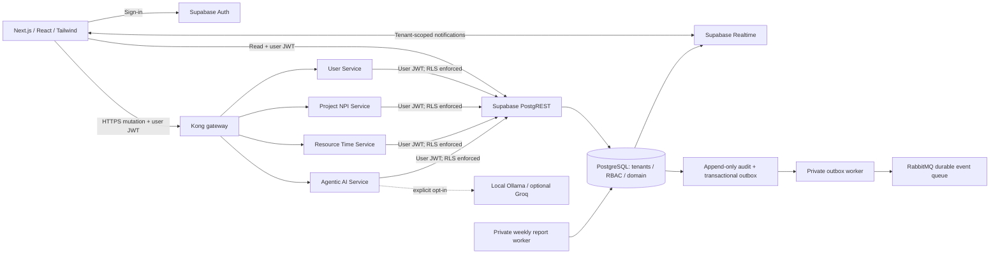

# Silicon Portfolio

An original semiconductor New Product Introduction portfolio and time-tracking application. Next.js management demo plus four authenticated FastAPI services, Supabase PostgreSQL/Auth/Realtime, Kong and RabbitMQ. Common PPM workflows are implemented independently; this project is not affiliated with Sciforma and does not claim full product parity or compliance certification.

## What you can demonstrate

- Executive dashboard: live-derived budget/spend, weighted expected return, health, strategic alignment and milestones.
- NPI projects: Ideation → Feasibility → EVT → DVT → PVT → Ramp/Launch; searchable portfolio, editable Gantt roadmap, task Kanban, sequential phase gates and design freeze.
- Demand funnel: IC design proposals, tape-out requests and fab capacity requests with review and approval.
- Capacity: specialized engineering skills/fab nodes, date-active allocations, availability and over-allocation warnings.
- Timesheets: project/task/phase mapping, billable/non-billable hours and submission.
- Portfolio agent: overlapping-allocation analysis, historical EVT/DVT delay comparisons, on-demand reports, and a Monday UTC draft-report worker. LangChain/Ollama/Groq are optional; deterministic calculations run without an API bill.
- Connected mode: authenticated tenants, database RBAC, audit trail and Realtime refetches.

**The published management demo uses fictional data and browser-local storage. Each visitor has an independent copy. It does not run the microservice stack, shared database, production audit controls, or an LLM.** Changes synchronize between tabs in the same browser, not between people. Use Reset demo in the sidebar to restore the samples. Do not enter confidential information in the public demo.

## Quick start: standalone demo

Prerequisites: Node.js 24, pnpm 11.19.0 (or compatible version), Git. No database or credentials required.

```sh
npm install -g pnpm@11.19.0
pnpm install --frozen-lockfile
pnpm dev
```

Open [localhost:3000](http://localhost:3000). To serve the exact static artifact:

```sh
pnpm build
pnpm preview
```

Next.js App Router exports to `apps/web/out`. Tailwind and shadcn/ui-compatible Radix Button/Dialog primitives are configured through `apps/web/components.json`. No external fonts, analytics or proprietary media assets are required.

## Connected local stack

Additional prerequisites: Docker Engine with Compose v2, Supabase CLI, and Python 3.13 for bootstrap/testing. On Windows, Docker Desktop/WSL2 are an option, but Docker Desktop has separate commercial-license conditions. Use open-source Docker Engine on Linux when Desktop licensing does not fit your organization.

Supabase CLI runs the PostgreSQL, Auth, PostgREST, Realtime and Studio containers with the official version-coupled configuration. This repository's Compose file runs the application services, gateway, broker and optional workers alongside that stack. Keeping the Supabase stack under its CLI avoids copying an incomplete Auth/Realtime Docker setup.

1. Start the local database stack from this repository:

   ```sh
   supabase start
   supabase migration up
   supabase status
   ```

2. Copy `.env.example` to `.env`. Set the local publishable/anon key from `supabase status`, generate a random URL-safe `RABBITMQ_PASSWORD`, and set `NEXT_PUBLIC_DATA_MODE=connected`. Use `http://host.docker.internal:54321` for container `SUPABASE_URL` and `http://127.0.0.1:54321` for browser `NEXT_PUBLIC_SUPABASE_URL`. The root `.env` is for Compose; direct Next builds use `apps/web/.env.local` (copy its example).

3. Provision the synthetic development tenant as documented in [database setup](docs/database.md). The bootstrap prompts for a development password and uses local operator credentials. Never put the service-role key in a `NEXT_PUBLIC_*` value. Hosted seeding requires an explicit flag and must target a nonproduction project.

4. Start the services:

   ```sh
   docker compose up --build -d
   docker compose ps
   ```

5. Open the frontend and sign in with the provisioned identity. The API revalidates the Supabase token; database membership determines permissions. New projects begin at Ideation; QA or a fab manager must approve the EVT design freeze before DVT.

6. Optional workers: set `SUPABASE_SERVICE_ROLE_KEY` and `WEEKLY_REPORT_TARGETS` (JSON mapping tenant UUID to the designated report-owner UUID), then:

   ```sh
   docker compose --profile workers up --build -d
   ```

   See [weekly reports](docs/weekly-reports.md). The outbox worker publishes committed changes to RabbitMQ with confirms, leases and retry. Delivery is at least once; future consumers must deduplicate event IDs. Monitor queue growth and consume/archive events.

Stop app containers with `docker compose down` and local Supabase with `supabase stop`. Neither instruction deletes volumes. Do not use reset or volume-deletion commands against real data.

### Optional local language model

Set `ENABLE_LLM=true`, `LLM_PROVIDER=ollama`, and an explicitly reviewed `LLM_MODEL`; start `docker compose --profile local-ai up --build -d`. Pull the chosen model into the Ollama container with its CLI. Model downloads consume disk/network resources; model-weight licenses are separate from Ollama's software license. `OLLAMA_NO_CLOUD=1` disables Ollama cloud features. Only requests with `use_llm:true` invoke the provider. Groq additionally requires `ALLOW_EXTERNAL_LLM=true` and a secret key; no cloud AI is enabled by default.

## Environment variables and ports

| Variable | Purpose |
| --- | --- |
| `NEXT_PUBLIC_DATA_MODE` | `demo` default, or `connected`; fixed at frontend build time |
| `NEXT_PUBLIC_SUPABASE_URL` | Browser-reachable Supabase URL; HTTPS outside localhost |
| `NEXT_PUBLIC_SUPABASE_ANON_KEY` | Public publishable/legacy anon key; security depends on RLS |
| `NEXT_PUBLIC_API_URL` | Kong URL; HTTPS in remote deployments |
| `SUPABASE_URL` | Server-reachable Supabase API origin |
| `SUPABASE_PUBLISHABLE_KEY` | Public key used with the caller's bearer token by APIs |
| `SUPABASE_SERVICE_ROLE_KEY` | Privileged secret, supplied only to worker/operator environments |
| `CORS_ORIGINS` | Explicit comma-separated frontend origins |
| `RABBITMQ_USER`, `RABBITMQ_PASSWORD` | Broker credentials; use URL-safe password for AMQP URL |
| `WEEKLY_REPORT_TARGETS` | Approved tenant/report-owner map; empty disables targets |
| `WEEKLY_REPORT_HOUR_UTC` | Monday run hour, default 08:00 UTC |
| `ENABLE_LLM`, `LLM_PROVIDER`, `LLM_MODEL` | Optional image build/provider settings |
| `ALLOW_EXTERNAL_LLM`, `GROQ_API_KEY` | Additional opt-in and secret for Groq |

Changing `NEXT_PUBLIC_*` values requires rebuilding the frontend. Never use a privileged key as the browser key.

| Component | Host port | Container port | Exposure |
| --- | --- | --- | --- |
| Next.js/static frontend | 3000 | 8080 | Loopback only |
| Kong gateway | 8000 | 8000 | Loopback only; Admin API disabled |
| User Service | none | 8000 | Internal network |
| Project NPI Service | none | 8000 | Internal network |
| Resource Time Service | none | 8000 | Internal network |
| Agentic AI Service | none | 8000 | Internal network |
| RabbitMQ AMQP | none | 5672 | Internal network |
| RabbitMQ management | 15672 | 15672 | Loopback only, password protected |
| Ollama (optional) | none | 11434 | Internal network |
| Supabase API (CLI) | 54321 | CLI-managed | Local development |
| Supabase PostgreSQL (CLI) | 54322 | 5432 | Local development |
| Supabase Studio (CLI) | 54323 | CLI-managed | Local development |
| Supabase local mail sink | 54324 | CLI-managed | Local development |

For standalone Python debugging, use host ports 8001 (user), 8002 (project), 8003 (resource/time), 8004 (agent); all Compose APIs use internal 8000. The service `/health` endpoint checks process liveness, not downstream readiness.

## Architecture



Database owner/operator credentials remain a separate trust boundary. Supabase service-role access bypasses RLS and belongs only in tightly controlled worker/provisioning environments. This is a modular microservice scaffold sharing a tenant-aware database; independent database-per-service ownership, service mesh, autoscaling and SSO are future production engineering.

See [repository tree](docs/repository-tree.md), [database schema/RLS](docs/database.md), [API contracts](services/README.md), [security readiness](docs/security-readiness.md), and [legal and hosting notes](docs/legal-and-hosting.md).

## Verification

```sh
pnpm test
pnpm typecheck
pnpm build
python -m venv services/.venv
# Windows: services/.venv/Scripts/python; Linux: services/.venv/bin/python
services/.venv/Scripts/python -m pip install -r services/requirements-dev.txt
services/.venv/Scripts/python -m pytest tests/backend -q
pnpm --dir supabase/tests --ignore-workspace install --ignore-scripts
node supabase/tests/run.mjs
```

The SQL harness applies the actual migration to embedded PostgreSQL (PGlite) with small Supabase Auth fixtures. It tests real PostgreSQL RLS/triggers but does not replace live Auth/PostgREST/Realtime or multi-connection testing. Build-machine results and remaining checks are recorded in [verification](docs/verification.md).

Docker Engine, Supabase CLI and a live Supabase project were not available on the build machine. The full Compose stack and connected integration must be exercised before any pilot with real data. Do not interpret successful unit/SQL checks as a production security assessment.

## Publishing and cost boundaries

The first synthetic demo is hosted using the available Sites publishing connection; see [deployment record](docs/deployment.md) for its confirmed link and repository. The source remains portable. For Cloudflare Pages, connect the private GitHub repository, use `pnpm install --frozen-lockfile && pnpm build`, and publish `apps/web/out`. Set `NEXT_PUBLIC_DATA_MODE=demo` and no secrets. Access permissions and provider terms still apply.

The demo needs no paid database, AI key, or always-on service. No paid services were provisioned. Free tiers have quotas and can change; the complete microservice infrastructure, availability commitments, compliant audit retention and operational controls cannot be guaranteed at zero cost. Vercel Hobby is not suitable for commercial use; GitHub Pages has commercial/SaaS restrictions. See the cited hosting comparison before choosing a business host.

## Security, ownership and legal use

This is a readiness foundation, **not ISO 27001 or SOC 2 certification, an automotive/medical qualification system, or a guarantee against legal issues**. Production use requires TLS on all hops, encrypted host volumes/backups, tested recovery, controlled administrator access, independent audit retention, privacy/retention procedures and an organizational review. Local HTTP/container volumes do not automatically provide enterprise encryption.

Only fictional data is included. Confirm employer/IP ownership before adoption; preserve dependency notices; review LLM model licenses; never send regulated/export-controlled silicon IP to a cloud service without the necessary organizational clearance. The project uses original product naming and UI rather than Sciforma assets or source. [Legal and hosting notes](docs/legal-and-hosting.md) provide the source-backed decision checklist. Consult qualified counsel for your jurisdiction and regulated use case; the code cannot supply legal clearance.
